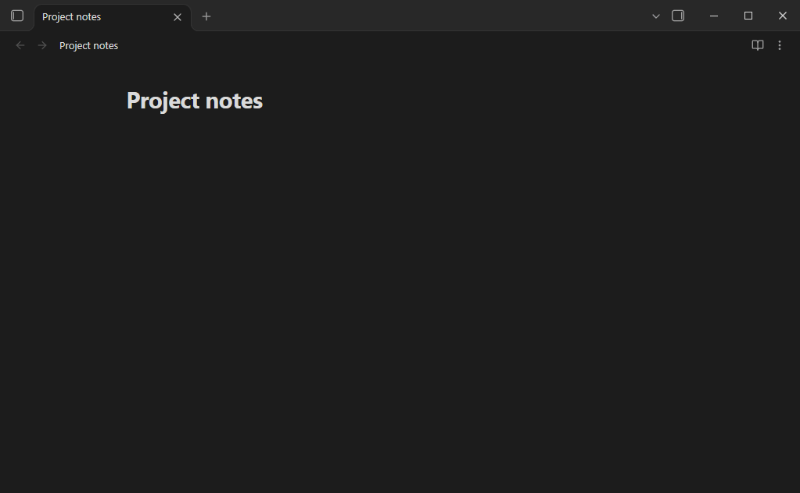

# Completr

[](https://github.com/tth05/obsidian-completr/releases)


Advanced auto-completion for Obsidian: LaTeX, front matter, callouts and regular writing.

## Features

- **LaTeX**
    - All MathJax commands and `\begin{...}` environments, no need to type the `\`
    - Works in `$...$` and `$$...$$` blocks, also while the block isn't closed yet
    - Snippets with placeholders: `\frac` inserts `\frac{}{}`, Enter jumps to the next placeholder
    - Rendered preview of each command in the popup
    - Add your own commands in the settings
- **Snippets**: your own text templates, e.g. a meeting note header, with placeholders to jump through
- **Inline suggestions** (optional): the best suggestion in grey after the cursor, `Tab` inserts it
- **Words**
    - Learns the words of your notes while you write, or scans the whole vault
    - Word lists: import files with one word per line. Fast, even with millions of words
    - Works with every script (Latin, Greek, Cyrillic, Devanagari, ...)
    - Optional fuzzy matching (`mkd` -> `markdown`), sorting and ranking by usage
    - Optional space after a completed word, and "Period after double space": pressing `Space` right after turns it
      into `. `, like on a phone keyboard
- **Front matter**: keys and values used anywhere in your vault, including tags and nested values like `Area/Topic`
  (in source mode)
- **Callouts**: `> [!` suggests callout types with their icons, optionally from the
  [Callout Manager](https://github.com/eth-p/obsidian-callout-manager) plugin



## Installation

Browse the community plugins list in Obsidian and search for `Completr`.

Manually: download `main.js`, `styles.css` and `manifest.json` from a [release](https://github.com/tth05/obsidian-completr/releases)
and copy them to `<vault>/.obsidian/plugins/obsidian-completr/`.

## Usage

### Keys

All keys are commands, change them under *Settings -> Hotkeys* (filter for "Completr").

| Command                          | Default                 |
| -------------------------------- | ----------------------- |
| Open suggestion popup            | `Ctrl/Cmd + Space`      |
| Select next / previous           | `ArrowDown` / `ArrowUp` |
| Insert selected suggestion       | `Enter`                 |
| Close suggestion popup           | `Escape`                |
| Jump to next snippet placeholder | `Enter`                 |
| Add selected to the blacklist    | `Ctrl/Cmd + Shift + D`  |
| Bypass the popup, press Enter    | `Ctrl + Enter`          |
| Bypass the popup, press Tab      | `Ctrl + Tab`            |
| Accept inline suggestion         | - (`Tab` always works)  |
| Toggle automatic popup           | -                       |
| Create snippet from selection    | -                       |
| Learn the words of all notes     | -                       |

- Keys that aren't used by the popup go to the editor as usual, e.g. `Shift + Tab` or `Home` close the popup and do
  their normal thing.
- Obsidian's hotkey settings can't bind a plain `Tab`. Enable *Insert with Tab* / *Jump to next placeholder with Tab* in
  the Completr settings instead.
- If *Select first suggestion* is disabled, `Enter` creates a new line until you pick a suggestion with the arrow keys.
- In vim mode, `Escape` closes the popup and leaves insert mode.
- A popup opened with `Ctrl/Cmd + Space` ignores the minimum typed length for the word it was opened on.

### Inline suggestions

Off by default, enable *Inline suggestions* in the settings. While you type, the rest of the best suggestion appears
in grey after the cursor, and `Tab` inserts it. `Escape` hides it until you type the next character. It works with or
without the popup: while the popup is open, it shows the selected suggestion, so `Tab` and the popup agree.

Only suggestions that continue exactly what you typed are shown (`hel` -> `hello`, not `Hello`), and none in the middle
of a word. To accept with another key, e.g. `ArrowRight`, assign it to the *Accept inline suggestion* command. That
key keeps working normally while nothing is shown.

### Blacklist

Hover a suggestion and click the eye icon, or select it and press `Ctrl/Cmd + Shift + D`, to never see it again. A
notice lets you undo that right away. Later, use *Manage* in the *Blacklist* section at the bottom of the settings.

### Custom LaTeX commands

Add them in the settings (*LaTeX -> Add LaTeX command*) or edit `latex_commands.json` in the plugin folder. In the
popup, hovering one of your commands shows a pencil icon that opens it for editing. The file contains a JSON array of
either strings or objects:

```json
["\\mycommand{#}", { "displayName": "\\myenv", "replacement": "\\begin{myenv}\n~\n\\end{myenv}" }]
```

In replacements, `#` marks a placeholder and `~` the final cursor position. The built-in commands can be disabled in the
settings.

### Snippets

Snippets work outside of math blocks: typing the start of a snippet's name suggests it, with the start of its text next
to it. Add them in the settings, with the *Create snippet from selection* command, or in `snippets.json` (same format as
the LaTeX commands).

A name can be anything. Starting it with a character like `:` or `/` (`:sig`, `/date`) keeps a snippet out of the way
of normal words: it is only suggested once that character and one more are typed.

Since `#` and `~` are common in markdown, snippets use a different placeholder syntax:

- `{{}}`: an empty placeholder
- `{{some text}}`: a placeholder pre-filled with "some text", which is selected so typing replaces it
- `{{cursor}}`: where the cursor ends up after the last placeholder

```json
[{ "displayName": "meeting", "replacement": "## Meeting {{title}}\nAttendees: {{}}\n\n{{cursor}}" }]
```

### Data files

Completr keeps its data in its plugin folder (`.obsidian/plugins/obsidian-completr/`):

- `scanned_words.txt`: words learned from your notes, one per line
- `wordLists/`: imported word lists
- `blacklisted_suggestions.txt`: the blacklist, one entry per line
- `latex_commands.json`: your own LaTeX commands
- `snippets.json`: your snippets
- `callout_suggestions.json`: callout types (unless Callout Manager is used)
- `suggestion_usage.json`: how often suggestions were used, for ranking

## Looking for word lists?

- https://sourceforge.net/projects/germandict/
- https://github.com/kpym/FrequencyDictionaries

## Development

Requires [Bun](https://bun.com) (currently a canary build for `bun lint`: `bun upgrade --canary`).

- Clone the repo into the `plugins` folder of a test vault, run `bun install` and `bun run dev`, enable the plugin
- `bun run build`: production build
- `bun check`: typecheck, lint and formatting check (`bun run fix` fixes what it can)
- `bun test`: unit tests
- `bun run test:e2e`: UI tests. Starts an isolated Obsidian instance with a temporary vault and drives it through the
  Chrome DevTools Protocol. Needs a local Obsidian installation (override with `OBSIDIAN_EXE`). `E2E_HEADED=1` shows
  the window, `E2E_KEEP=1` keeps it open after the run.
